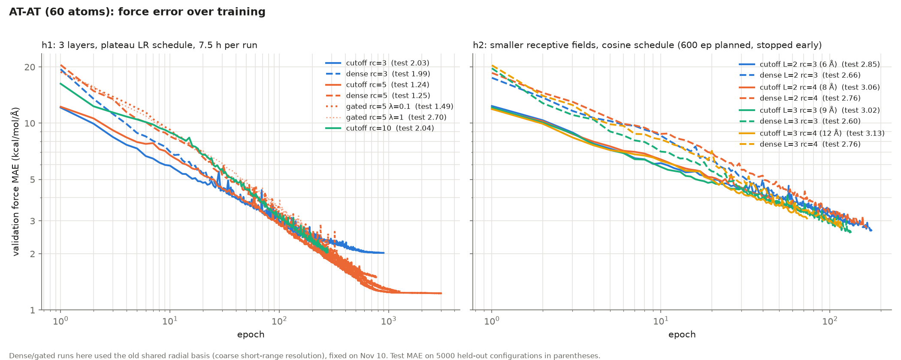
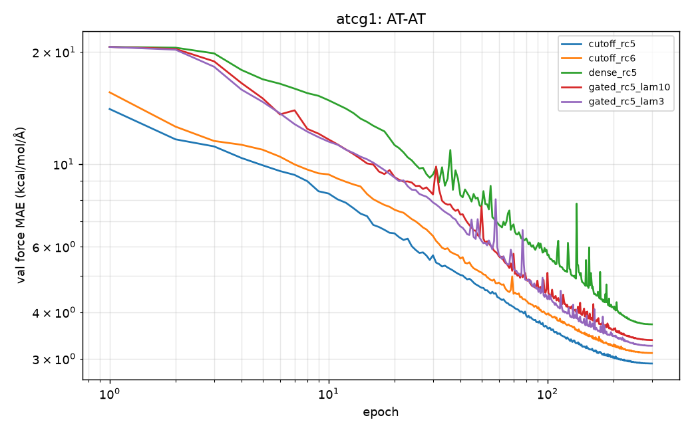

# Which atoms need to talk? Experiment log, Nov 9–10, 2026 (updated Nov 10, evening)

CS224W project (Viktor Imrisek, Emiyare Ikwut-Ukwa). This is a working log of the first two days of
experiments, written to share where things stand. All numbers are force mean absolute errors (MAE) in
kcal/mol/Å unless stated otherwise. Lower is better.

> **⚠️ Warning: all results so far use a random frame split, which leaks between train and test.**
> MD22 frames come from one continuous trajectory. Random sampling interleaves train/val/test along
> it: a test frame's nearest training frame is typically only 2–3 steps away, and ~30% of test
> frames sit right next to a training frame. Absolute errors below are therefore optimistic
> (partly interpolation along the trajectory). Comparisons between models are less affected, since all
> share the split. We propose a blocked split with gaps for all results from now on (Section 1.1).

## TL;DR

1. **The original gating idea has no room to help on these molecules.** On AT-AT (60 atoms), a plain
   3-layer, 5 Å cutoff model matches a model with every long-range edge added (test 1.24 vs 1.25).
   Three message-passing layers already see ~15 Å, about the whole molecule.
2. **On the bigger AT-AT-CG-CG (118 atoms, ~20 Å across), long-range edges looked harmful at first**
   (cutoff 2.88 vs dense 3.67). That came from a flaw in our model: short- and long-range edges
   shared one distance encoding, which blurred the short-range one about 5×. After the fix, dense
   tracks cutoff epoch for epoch (4.37 vs ~4.45 at epoch 59; runs not finished).
3. **Transfer looks promising, and it is local.** The AT-AT model, applied to AT-AT-CG-CG with *no*
   retraining, already beats a model trained from scratch on 2,000 AT-AT-CG-CG configurations on
   atoms far from the new C/G bases (1.50 vs 2.29). Its errors concentrate on C and G and their
   immediate neighbours.
4. **New direction (Section 6): learned sparse graphs at a fixed edge budget.** Instead of asking
   whether long-range edges beat a 5 Å graph, ask which few extra edges a cheap 3 Å graph needs to
   approach 5 Å accuracy. The 5 Å graph has ~2.7× more edges, and step time scales with edges.
   Candidates are ranked by an over-squashing-style **influence gap**: how much more
   ∂F_i/∂r_j the 5 Å model has than the 3 Å model. On AT-AT, the gap picks are enriched for edges
   between bases (43–50% vs 17–30% for raw influence). A first AT-AT sweep (`runs/edges_atat`) was
   started and stopped early. It will be rerun with a longer, extendable LR schedule and the blocked
   split (Section 6.4). Transfer to AT-AT-CG-CG becomes the second experiment (Section 7).

## 1. Setup

**Data: MD22** (molecular-dynamics snapshots with DFT energies and per-atom forces, PBE+MBD).
- **AT-AT**: 60 atoms, two stacked A–T base pairs, 4 covalent fragments, max pair distance ~17 Å.
- **AT-AT-CG-CG**: 118 atoms, 8 separate nucleobases (2 each of A, T, C, G), max pair distance ~20.5 Å.
- Splits: a fixed random permutation (seed 1234), not the official MD22 split. AT-AT uses
  3000 train / 500 val / 5000 test. AT-AT-CG-CG uses 2000 / 500 / 2000. **This split leaks; see 1.1.**

### 1.1 Data split: the leak and the proposed fix

**The leak** (`src/split_check.py`). Every frame comes from one MD trajectory, and the random split
interleaves train, validation and test along it.

| dataset | frames | test → nearest training frame (median) | test frames adjacent to a training frame | max distance |
|---|---|---|---|---|
| AT-AT | 20,001 | 3 frames | 29% | 22 frames |
| AT-AT-CG-CG | 10,153 | 2 frames | 35% | 16 frames |

How fast the trajectory changes (both molecules nearly identical):

| frame lag | 1 | 2 | 5 | 10 | 20 | 50 |
|---|---|---|---|---|---|---|
| force correlation | 0.92 | 0.73 | 0.00 | −0.21 | 0.27 | −0.05 |
| RMS atom displacement (Å) | 0.02 | 0.04 | 0.10 | 0.17 | 0.24 | 0.37 |

Forces decorrelate within ~5 frames (fast bond vibrations), and geometry changes more slowly. So about
a third of test frames have a near-duplicate in training: forces 92% correlated, atoms ~0.02 Å apart.

**Consequences:**
- Absolute test errors are optimistic. They match how sGDML/MD22 benchmarks usually sample, so they
  remain comparable to published numbers, but they overstate generalization.
- Model-vs-model comparisons share the leak, so they're only mildly affected. The leak can slightly
  favour models that fit training data more closely, which tend to be larger graphs.
- It matters most for generalization-type claims: transfer AT-AT → AT-AT-CG-CG, and whether a
  selected graph learned something general rather than memorized the trajectory.

**Proposed split: blocked, with gaps.**
1. Cut the trajectory into B ≈ 20 contiguous blocks of equal length (AT-AT: ~1000 frames each).
2. Assign whole blocks to train / validation / test (e.g. 14 / 2 / 4), spread over the trajectory
   (e.g. a fixed shuffled block order, or every 5th block to test), so all three sets cover early and
   late parts of the run. A plain "first 70% train, last 30% test" split would mostly measure drift
   instead.
3. Drop a buffer of G ≈ 50 frames at every boundary between blocks of different sets. Then no evaluation
   frame is within 50 steps (~0.4 Å RMS, forces fully decorrelated) of a training frame.
4. Subsample the training budget (3000 / 2000 configurations) uniformly from the training blocks, so
   the number of training configurations stays as before.
5. Fix the block assignment once per dataset (save the indices to `data/<name>_split.npz`) so every
   run uses the same split.

**Reporting:** main results on the blocked split; the random split as a secondary number comparable to
the literature. Checks once implemented: rerun `split_check.py` on the new split (nearest training
frame ≥ G), and compare a model's error on random vs blocked test sets to measure how optimistic the
old numbers were.

**Knock-on effects:** the edge-selection teacher and student (`runs/h1/cutoff_rc5`, `cutoff_rc3`) were
trained on the random split. The selection only uses their training frames, so it's still valid, but
retraining both on the blocked split (~1 h on the Mac) is cleaner before the main sweep.

**Model** (`src/train.py`, plain PyTorch): SchNet-style continuous-filter convolutions, 64 features,
L layers. Forces are −∂E/∂positions; the loss is per-atom energy MSE plus force MSE.
- **cutoff**: messages only between atoms closer than `rc`.
- **dense**: adds a second "long-range" channel over every pair with rc ≤ d < rl, with a smooth
  window (rl = 20 Å on AT-AT, 24 Å on AT-AT-CG-CG). Layer 0 is always short-range only.
- **gated**: like dense, but each long-range edge is multiplied by a learned gate
  g = sigmoid(MLP(h_i + h_j, h_i ⊙ h_j, rbf(d))), computed from layer-0 embeddings, plus a sparsity
  penalty λ·mean(g).
- Neighbour sums are divided by the average neighbour count. The readout is zero-initialized, and
  gradients are clipped at 1000. Without these, models with many neighbours stalled at zero force.

**Fragments** (`src/fragments.py`): connected components of the covalent bond graph
(d < r_cov,i + r_cov,j + 0.4 Å on the median geometry). Each nucleobase is one fragment. On
AT-AT-CG-CG, nearly every pair beyond 5 Å crosses between fragments (94% at 5–8 Å, 100% beyond
8 Å). Any "does the gate keep inter-fragment edges" analysis therefore has to compare at matched distance.

## 2. Experiment 1: is there headroom on AT-AT? (`runs/h1`, `runs/h2`)

Question: does adding long-range edges beat a plain cutoff model? If not, gates have nothing to select.

**h1** (3 layers, plateau LR schedule, 7.5 h wall-clock per run, Mac M4 Pro):

| model | epochs | test force MAE |
|---|---|---|
| cutoff rc=5 | 3011 | **1.24** |
| dense rc=5 | 1269 | 1.25 |
| gated rc=5, λ=0.1 | 777 | 1.49 (gates ~95% above 0.1) |
| gated rc=5, λ=1 | 169 | 2.70 |
| cutoff rc=3 | 898 | 2.03 |
| dense rc=3 | 280 | 1.99 (still improving) |
| cutoff rc=10 | 276 | 2.04 (slow per epoch) |

**h2** (smaller receptive fields L·rc = 6–12 Å, cosine schedule planned for 600 epochs, stopped
after 73–178 epochs): cutoff and dense track each other at matched epochs after about epoch 30.
The final test numbers (dense 2.60–2.76, cutoff 2.85–3.13) mostly reflect that the CPU-run cutoff
models got fewer epochs.

**Conclusion:** no headroom on AT-AT. A 15 Å receptive field covers the molecule, and even 6–12 Å
didn't open a gap. Caveat: all dense/gated runs here used the flawed shared distance encoding
(Section 4), which may explain why dense starts worse in early epochs.

## 3. Experiment 2: headroom and gates on AT-AT-CG-CG (`runs/atcg1`)

Bigger molecule, same settings (L=3, rc=5 so reach ~15 Å < ~20 Å molecule), 2000 training
configurations, 300-epoch cosine schedule for every run.

| model | best val | test force MAE | long-range edges / molecule | gates |
|---|---|---|---|---|
| cutoff rc=5 | 2.91 | **2.88** | 0 | – |
| cutoff rc=6 | 3.11 | 3.08 | 0 | – |
| gated λ=3 | 3.25 | 3.22 | ~11,300 | mean 0.81, 91% > 0.1 |
| gated λ=10 | 3.37 | 3.33 | ~11,300 | mean 0.67, 77% > 0.1 |
| dense rc=5 | 3.71 | 3.67 | ~11,300 | – |

At face value, long-range edges hurt. But dense also had a much worse *training* loss (23.4 vs
14.7), so this was an optimisation or modelling problem, not overfitting. That led to the fix below.

## 4. The distance-encoding flaw and the fix (`runs/atcg2`, partial)

Short- and long-range edges shared one set of 50 Gaussian distance features. In the cutoff model they
span 0–5 Å (0.1 Å apart). In dense/gated they spanned 0–24 Å (~0.5 Å apart), leaving only ~10
features for the 0–5 Å range where nearly all the chemistry is.

Fix (now in `src/train.py`):
- separate bases: 0–rc for short edges, rc–rl for long edges;
- the long-range channel's filter is zero-initialized, so at initialization dense/gated produce
  exactly the cutoff model's output (verified). Any gain from long-range edges is then real headroom.

Rerun on a Colab T4 (`colab/atcg2_colab.ipynb`). It was cut off by Colab's runtime limit, so these
are partial runs. The T4 was slower than the Mac (cutoff 23 s/epoch vs 9 s alone on the Mac).

| model | epochs done | best val | val at matched epoch, before → after fix |
|---|---|---|---|
| cutoff rc=5 | 160 | 3.10 | 3.17 → 3.10 (epoch 160; cutoff is unaffected by the fix) |
| dense rc=5 | 59 | 4.37 | 6.96 → 4.37 (epoch 59; cutoff ≈ 4.45 there) |
| gated λ=3 | 46 | 5.39 | 6.36 → 5.39 (epoch 46) |
| gated λ=10 | 46 | 5.25 | 6.63 → 5.25 (epoch 46; gate mean fell to 0.28, 56% > 0.1) |

The fix removed the penalty: dense now matches cutoff at equal epochs. Whether long-range edges
*help* on this molecule is still open. That needs the runs finished; the checkpoints in
`runs/atcg2` can be resumed with `--resume`.

## 5. Experiment 3: zero-shot transfer AT-AT → AT-AT-CG-CG

The trained AT-AT cutoff model (h1, test 1.24 on AT-AT), evaluated on the 2000 AT-AT-CG-CG test
configurations with no retraining. Errors are split by which nucleobase each atom belongs to.

| model | all | A | T | C | G |
|---|---|---|---|---|---|
| predict zero force | 20.6 | | | | |
| AT-AT model, no retraining | 7.97 | 4.58 | **1.55** | 10.3 | 15.3 |
| trained from scratch on 2000 AT-AT-CG-CG (atcg1 cutoff) | 2.88 | 3.06 | 2.37 | 2.75 | 3.31 |

A/T atoms only, by distance to the nearest C or G atom:

| distance to nearest C/G | n atoms | no retraining | from scratch |
|---|---|---|---|
| < 3.5 Å | 21 | 4.23 | 3.09 |
| 3.5–5 Å | 19 | 3.22 | 2.75 |
| 5–7 Å | 5 | 2.28 | 2.31 |
| 7–10 Å | 15 | **1.50** | 2.29 |

The transferred model is already better than 2000 configurations of from-scratch training wherever
the local environment looks like AT-AT. Its errors sit on the unseen C/G bases and their close
neighbours. Energies don't transfer zero-shot (different composition, so a different energy offset),
so all transfer comparisons use forces. The no-retraining error (7.97) is about where from-scratch
training was after ~10 of its 300 epochs.

## 6. New main direction: which edges does a cheap graph need? (edge budget + influence)

The gating proposal asked whether long-range edges beat a cutoff graph. On MD22's DNA systems they
don't: the cutoff graph already sees almost everything. Two TA concerns also apply: soft gates
don't save compute, and gates built on per-model embeddings don't transfer cleanly.

But our runs show headroom in the other direction. On AT-AT, a 3 Å graph reaches 2.03 and a 5 Å graph
1.24, and the 5 Å graph has ~2.7× more edges. **New question: at a fixed edge budget, which edges should a
message-passing force field use?** Can a 3 Å graph plus a few selected edges recover most of the
3 Å → 5 Å gap at a fraction of the cost? This keeps the proposal's question ("which atoms need to
talk?") but makes the compute savings real: unselected edges are never computed.

### 6.1 Cost scales with edges (AT-AT-CG-CG, one training step, batch 16, Mac M4 Pro GPU)

| graph | edges / atom | edges between bases / atom | ms / step (GPU) | ms / step (CPU) |
|---|---|---|---|---|
| 3 Å | 7.6 | 0.8 | 18 | 71 |
| 4 Å | 13.4 | 3.7 | 29 | 114 |
| 5 Å | 21.6 | 9.3 | 49 | 193 |
| 6 Å | 31.1 | 17.5 | 66 | 260 |

About 2.2 ms per extra edge per atom, so 3 Å + 4 selected edges/atom ≈ 1.6× faster than 5 Å
(ceiling 2.7×). Note that the 3 Å graph is almost entirely within-base: bases barely talk.
On 60-atom AT-AT the GPU is overhead-bound (12 vs 21 ms/step), so the savings case gets stronger
with molecule size.

### 6.2 Over-squashing-style influence

Influence of atom j on atom i in a trained model: I_ij = ‖∂F_i/∂r_j‖ (3×3 block of the model's Hessian).
This is the force-field version of the sensitivity Jacobian used in over-squashing analyses
(Topping et al.). Computed by autograd, ~1–3 s per configuration on CPU.

Exploration on the 5 Å AT-AT-CG-CG model (30 test configurations, `src/influence_explore.py`):
- Influence decays steeply: mean 98 at 2–3 Å, 17 at 3–4 Å, 5.7 at 4–5 Å, 1.8 at 5–6 Å, 0.03 at 8–12 Å.
- In the 3–5 Å shell (edges a 3 Å graph lacks) it is moderately concentrated: the top 25% of pairs
  carry 62% of the influence.
- It is stable across configurations (rank correlation 0.84 with the mean), so a fixed edge list
  for one molecule is reasonable.
- It is not just distance: top-25% by influence overlaps only 60% with the nearest 25%.
- At matched distance, same-base pairs have ~2× more influence than pairs between bases.

**Why raw influence is not the right selection criterion.** It is end to end: if j affects i through
a 2-hop path in the 3 Å graph, the 3 Å model can carry that influence without a direct edge.
**Selection criterion: the influence gap** relu(I_teacher − I_student) between a 5 Å teacher and a
3 Å student: influence the narrow graph fails to carry (is over-squashed). Edges go where the gap is
largest.

### 6.3 Edge lists for AT-AT (`src/edge_select.py`, `data/edges/AT-AT/`)

Teacher `runs/h1/cutoff_rc5`, student `runs/h1/cutoff_rc3`, influence averaged over 200 training
configurations. Candidates: 286 pairs with median distance 3–5 Å. Budget k = extra edges per atom
on average (k·60/2 pairs).

| method | k=1: between bases | k=2: between bases | k=4: between bases | k=4: overlap with nearest |
|---|---|---|---|---|
| influence gap | **43%** | **50%** | **49%** | 52% |
| raw teacher influence | 17% | 30% | 32% | 70% |
| nearest (median distance) | 20% | 17% | 31% | 100% |
| random | 40% | 37% | 37% | 42% |

The gap picks edges between bases far more than raw influence does. Within-base influence the
3 Å model already routes through short paths; the influence it fails to carry is between bases.
That's the over-squashing picture: the bottleneck is the few edges connecting the bases.

### 6.4 Model and sweep (`--mode pairs` in `src/train.py`, `runs/edges_atat.py`)

- **Model:** a 3 Å cutoff model plus a fixed list of extra atom pairs, in layers ≥ 1. They go through a
  separate filter with its own 0–7 Å distance basis, a cosine cutoff at 7 Å, and a zero-initialized
  output, so the model starts as the plain 3 Å model.
  A fixed list has no runtime scoring cost and no rank swaps, so the energy stays smooth.
- **First sweep (Nov 10, stopped after ~30 min):** plain cutoff 3/4/5 Å, plus 3 Å + {gap, nearest,
  teacher, random} at k = 1, 2, 4. All 400-epoch cosine, 3000 training configurations, 2 seeds.
  Six runs got 57–236 epochs (checkpoints in `runs/edges_atat`, resumable). Early on, the 3 Å + 2-edge
  models led all plain cutoffs at equal epochs (~3.4 vs 3.9–4.2 at epoch 37), with no difference
  between selection methods yet.
  - Stopped because 400 epochs is too short: in the long h1 runs, 5 Å was at 1.61 by epoch 400 and
    1.24 by epoch 1500, while 3 Å was nearly done. A short budget compresses the gap we want to measure.
  - Also stopped because of the split leak (Section 1.1).
- **Planned rerun:**
  - **Split:** the blocked split.
  - **Schedule:** warmup–stable–decay (WSD) instead of cosine-to-zero, optionally with weight
    averaging (EMA). The constant-LR phase can be extended freely, and any saved checkpoint can be
    "finished" with a short decay. That gives each model accuracy vs training budget (e.g. at 200 /
    400 / 800 / 1600 epochs) from one run.
  - **First runs:** seed 0 for cutoff 3/4/5 Å and the four methods at k = 2, 4 (11 runs). Second
    seed and k = 1 afterwards.
  - **Output:** force error vs ms/step and vs training budget, against the 3/4/5 Å reference curve.
- **Win condition:** gap-selected edges beat nearest/random at equal budget and lie below the
  cutoff-radius curve (better accuracy at equal cost).

### 6.5 Design notes and open choices

- **Scorer for new molecules.** A fixed list only fits one molecule. To transfer, train a cheap
  scorer to predict the influence gap. Candidates: an element-pair × distance table (tiny,
  interpretable, independent of model embeddings) or a factorized dot product of small per-atom
  vectors plus a distance term (~30 FLOPs per pair). The current MLP gate costs about as much as a
  message, so it can't save compute.
- **Smoothness.** If selection is recomputed per configuration, hard top-k makes the energy jump
  when ranks swap. Edges must fade in and out (a smooth step of score − threshold) and be computed
  only where the weight is > 0.
- **Budget control.** A fixed sparsity penalty λ left gates mostly open in our runs. Control the
  average number of edges directly instead.
- **Selection rule.** Global top-K per molecule (budget goes where it's needed) vs fixed k per atom.
- **Reach.** A 5 Å teacher can only nominate within its own receptive structure. For longer-range
  candidates, use the dense model (with the fixed distance encoding) as teacher.
- **Data.** For a system where long-range interactions matter by construction, the best next
  dataset is the MD22 buckyball catcher (148 atoms, host + C60 guest). Short-cutoff MACE
  lets it fall apart in MD (Kovács et al. 2023), and host/guest gives a clean ground truth for
  interface edges. Not downloaded yet.

## 7. Second direction: transfer AT-AT → AT-AT-CG-CG

Builds on Section 5. Kept as the second experiment, and combinable with Section 6: does the selected
graph (or a learned scorer) carry over, and does fine-tuning converge faster than from scratch?

- **Q1 (application): how many AT-AT-CG-CG labels and how much training does AT-AT pretraining save?**
  Test error against number of target configurations (25 → 2000) for: from scratch, full
  fine-tuning, fine-tuning with early layers frozen, and no retraining. Headline: labels needed to
  match from-scratch-on-2000, and gradient steps to reach it. Pretraining cost is reported
  separately. In wall-clock including pretraining (7.5 h) there's no win on this pair; the claim
  is "given an existing model" and fewer expensive DFT labels.
- **Q2 (graph learning): can we predict, without labels, where the transferred model will be wrong?**
  (a) error against graph distance to unseen chemistry (Section 5 is the first version);
  (b) embedding novelty, i.e. distance from an atom's representation to the nearest AT-AT training
  atom, as a label-free error predictor; (c) receptive field against transferability: smaller
  reach should transfer better but cap accuracy lower, larger reach (including the dense long-range
  channel) the reverse.
- **Q3 (stretch):** use novelty to choose which configurations to label or which atoms to weight.

Generality is limited to one pair of molecules; the reverse direction (AT-AT-CG-CG → AT-AT) is a
cheap second data point.

## 8. Reproducing

See `README.md` for setup and commands. Run directories contain `args.json` (exact arguments),
`log.csv` (per-epoch metrics), `test.json` (final test metrics, if finished) and checkpoints
(`best.pt` = best validation, `last.pt` = for resuming).
